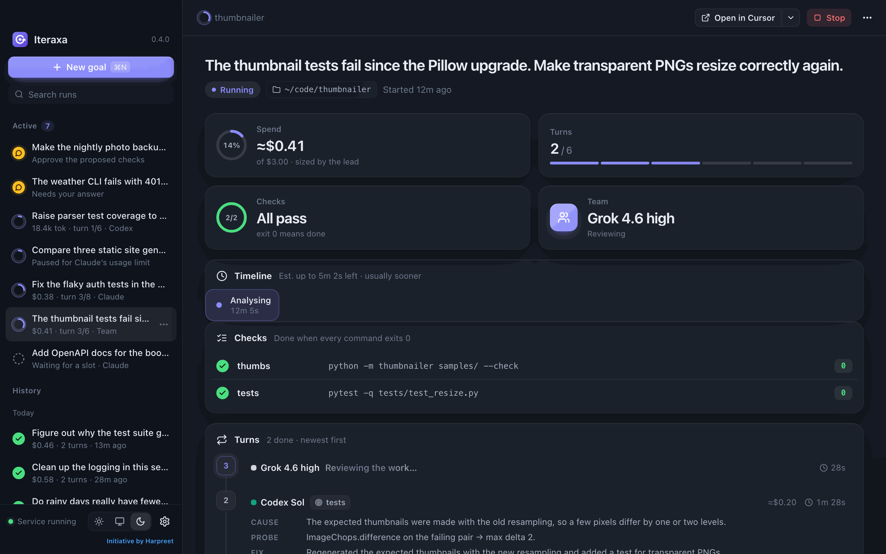
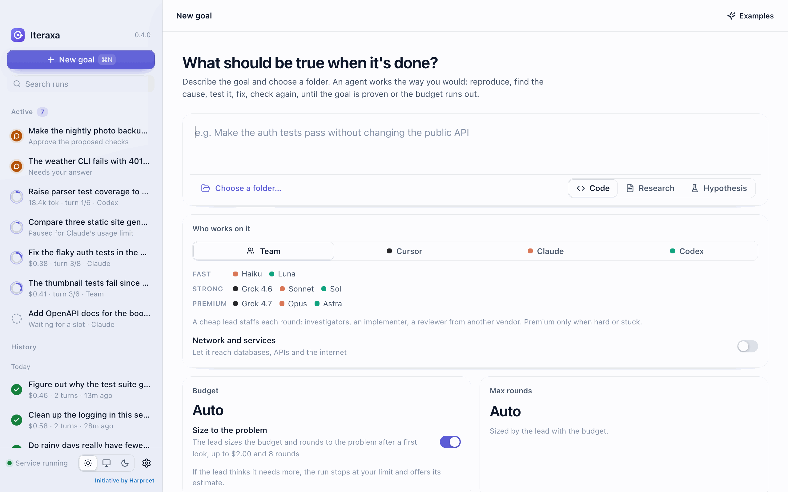
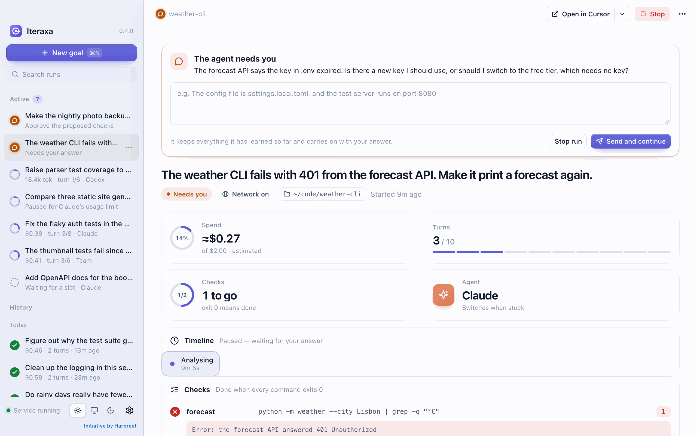
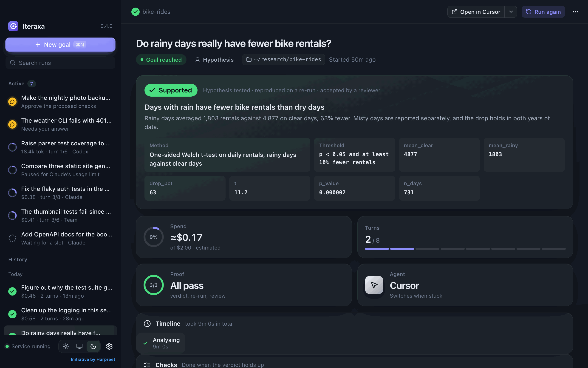
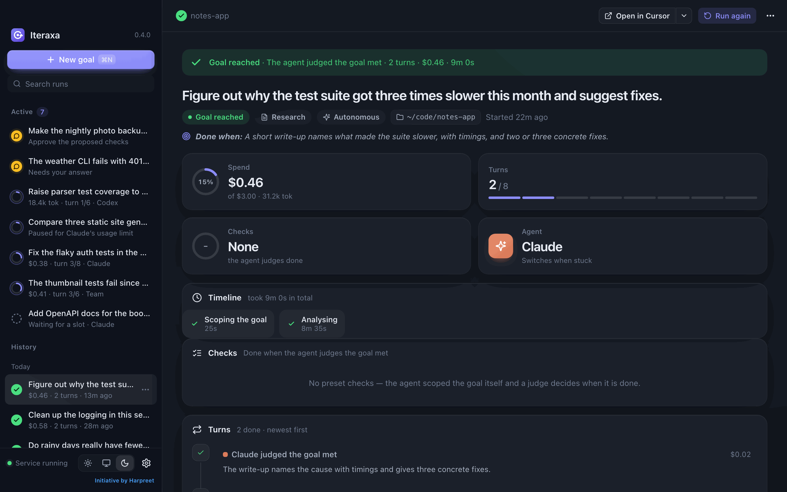
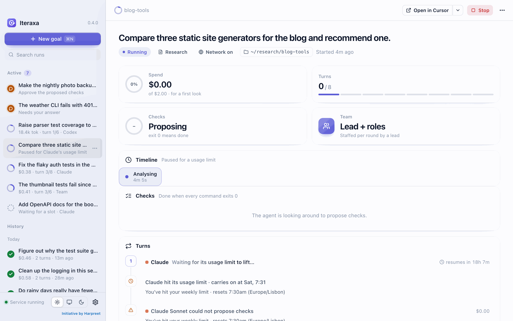
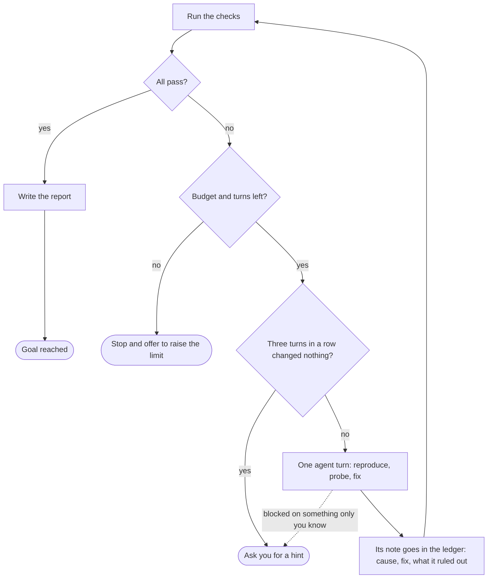
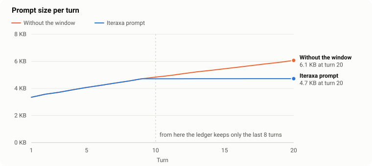

# Iteraxa

**Hand a goal to Claude Code, Codex or Cursor, and let them keep at it until it's really done.**

You know the routine with coding agents. You ask for a fix, run the tests, paste the error back, notice it's trying the same thing again, switch models, and keep one eye on the bill. Iteraxa does that routine for you.

Describe what should be true when you're done and pick a folder. Iteraxa keeps an agent working, turn after turn, until your checks pass, the budget runs out, or it needs something only you know. Then it asks you, and carries on once you've answered.

It's a desktop app for macOS and Ubuntu, and everything runs on your own machine.



## Why you might like it

- **It keeps going.** Every turn the agent reproduces the problem, names a likely cause, checks it, and fixes it. Then Iteraxa runs your checks again.
- **It remembers what didn't work.** Each turn leaves a short note of what it tried and ruled out, so the next turn doesn't walk into the same dead end.
- **It watches the bill.** Prompts stay small however long a run goes, you set a budget, and a team uses cheap models for the easy parts.
- **It asks instead of guessing.** Stuck three turns in a row, or missing something like an API key? It pauses and asks you.
- **It works as a team if you like.** A cheap lead staffs each round with investigators, an implementer and a reviewer, from another vendor whenever one is installed.

## Get started

**1. Install at least one agent CLI and sign in to it.**

| Agent | Install |
| --- | --- |
| Claude Code | `npm install -g @anthropic-ai/claude-code` |
| Codex | `npm install -g @openai/codex` |
| Cursor | `curl https://cursor.com/install -fsS \| bash` (Iteraxa uses `cursor-agent`, not the `cursor` editor command) |

**2. Build and install Iteraxa.**

```sh
git clone https://github.com/hss245/iteraxa.git
cd iteraxa
./install.sh
```

On macOS the script uses Homebrew to install Go, Rust and Python, builds the app from source, and puts `Iteraxa.app` in `~/Applications`. Because the app is built on your Mac, it opens without a Gatekeeper warning. On Ubuntu (22.04 or later) it installs the build packages with apt and Rust with rustup, then builds and installs a `.deb`. The first build takes a few minutes.

You'll need Python 3.10 or later as `python3`. The macOS script installs one, and Settings → Agents can point at a different one.

**3. Give it a goal.** Open Iteraxa and press **⌘N**:

1. Describe what should be true when it's done, and choose the folder the agent may change.
2. Pick **Team** (the default) or a single agent. Leave **Network and services** off unless the goal needs a database, an API or the internet.
3. Add a check (a shell command that exits 0 when the goal is met), or leave the checks empty. Iteraxa suggests checks from your project files and fills in the first one; clear it if you'd rather have none.
4. Press **Start** (⌘↵) and watch the turns come in.



## What can I ask it?

| Kind | For example | It's done when |
| --- | --- | --- |
| **Code** | "The thumbnail tests fail since the Pillow upgrade. Make transparent PNGs resize correctly again." | Every check command exits 0 (on a team, a reviewer also has to accept the change) |
| **Research** | "Compare three static site generators for the blog and write `findings.md` with sources." | Same rule: anything a shell command can check |
| **Hypothesis** | "Days with rain have fewer bike rentals than dry days." | The agent writes a verdict, supported or rejected. Iteraxa re-runs the analysis to confirm the numbers match, then a second agent reviews the reasoning, from another vendor when one is installed |

**No checks? That's fine.** Leave them empty and one of two things happens:

- **Work autonomously on** (the default): an agent scopes the goal itself and works on it. A read-only judge (the cheapest model, on a team) decides when the result is good enough, or when more rounds aren't worth the money. It still stops to ask you if the goal is unclear, if it gets stuck, or if an agent needs something only you know. Have a look at [what runs on your machine](#is-it-safe) first.
- **Work autonomously off**: an agent looks around the folder and proposes checks, and you approve or edit them before any work starts.

| | |
| --- | --- |
|  |  |
| **It asks when it's stuck.** The run pauses with a question and carries on once you answer. | **Hypotheses are checked twice.** The verdict only stands if a re-run reproduces it and a reviewer accepts it. |
|  |  |
| **Autonomous runs.** With no checks, it scoped the goal itself and a judge called it done. | **Usage limits.** When every agent is out of quota, the run waits for the reset and carries on. |

## How it works



Every turn is a **fresh agent call**, not one long chat. The folder on disk is the memory, plus a short ledger of the last turns' notes, what's been ruled out, and your answers.

When the same failure keeps coming back (numbers, ports and timestamps are ignored when comparing), the run counts as stuck:

- A single agent hands over to another installed agent (with **Switch when stuck** on), and Codex and Cursor turns raise their reasoning effort.
- A team brings in stronger models.
- After three turns in a row with no change, it stops and asks you instead of spending more.

When a run stops on its budget or turn limit, you get **Raise the limit and continue**, and it picks up with everything it learned. When the goal is reached, you also get a short report, written for a person rather than a terminal, to keep or share.

Closing the window doesn't stop anything: runs belong to a small background service, and reopening the window picks them back up, history included. Two runs work at once by default, the rest wait in a queue, and only one run works in a folder at a time.

### Working as a team

In a team round, a cheap lead plans the work. Investigators test theories in throwaway copies of your folder. An implementer makes the fix, and a reviewer (from another vendor whenever one is installed) reads the diff. If the run gets stuck, several models compete in separate copies. Iteraxa runs your checks in each copy, and applies the best one only if it does better than your folder does now.

| Tier | Claude | Codex | Cursor |
| --- | --- | --- | --- |
| Fast | Haiku | Luna | |
| Strong | Sonnet | Sol | Grok 4.6 (high) |
| Premium | Opus | Astra | Grok 4.7 (extra-high) |

Premium models only come in for hard problems or when the run is stuck. The full staffing rules are in [How Iteraxa works](docs/how-it-works.md#how-a-team-is-staffed).

## Keeping costs down

<picture>
  <source media="(prefers-color-scheme: dark)" srcset="docs/prompt-size-dark.svg">
  
</picture>

The prompt stays about the same size however long a run goes. It holds the brief, the last 8 turns' notes, up to 12 ruled-out causes, and the tail of each failing check's output. The chart compares it with the same prompt without the 8-turn window. Both lines are measured with the real loop code on a synthetic 20-turn run; [`scripts/prompt-size-chart.py`](scripts/prompt-size-chart.py) reproduces them.

<details>
<summary>The numbers behind the chart</summary>

| Turn | Iteraxa prompt | Without the window | Ledger as JSON | Ledger as TOON |
| --- | --- | --- | --- | --- |
| 1 | 3,345 B | 3,345 B | 2 B | 0 B |
| 4 | 3,894 B | 3,894 B | 650 B | 550 B |
| 8 | 4,535 B | 4,535 B | 1,459 B | 1,191 B |
| 12 | 4,711 B | 5,084 B | 1,677 B | 1,367 B |
| 16 | 4,715 B | 5,566 B | 1,681 B | 1,371 B |
| 20 | 4,717 B | 6,064 B | 1,683 B | 1,373 B |

</details>

The ledger is written in [TOON](https://github.com/toon-format/toon), about 18% smaller than the same ledger in JSON. A few other things help:

- **Claude** is capped with `--max-budget-usd` at whatever is left, so a single turn can't overshoot.
- **Codex** reports tokens, not dollars, so Iteraxa estimates the cost from OpenAI's API prices and marks it with ≈. With a ChatGPT sign-in your plan pays instead.
- **Cursor** reports neither, so Iteraxa estimates from the streamed text, also marked ≈. The real figure is a bit higher, because Cursor's hidden system prompt isn't counted.
- **On a team**, members working in parallel split what is left. Claude members are held to their share; Codex and Cursor calls are bounded by the 10-minute call timeout, and the budget is checked again before the next turn.
- **The final report** may use up to $0.40 even when the budget is spent, so a run that reached its goal can finish slightly over.
- **Lean mode** (on by default) runs Claude with `--bare` when `ANTHROPIC_API_KEY` is set in the app's environment, which skips hooks, plugins and `CLAUDE.md` discovery. A key exported only in your shell profile isn't seen when you open the app from the Dock. With a Claude.ai sign-in, Claude runs normally.

## Usage limits

When an agent's account hits its usage limit ("weekly limit · resets 7:30am"), every model from that vendor sits out and the run carries on with another installed agent.

If every agent is out and at least one is only waiting on a limit, the run **pauses**. It reads the reset time from the agent's own message, or retries in 30 minutes if it can't, then carries on by itself. While it waits it keeps its place among the runs working at once. An agent CLI you install during the pause takes over within a minute. A signed-out or crashing agent doesn't cause a pause: if nothing else is left, the run stops and shows each agent's own message.

## Is it safe?

Iteraxa runs agents and shell commands on your machine, in the folder you choose. Here's what each vendor may do.

| | Claude Code | Codex | Cursor |
| --- | --- | --- | --- |
| Read-only roles (lead, reviewer, judge, proposing checks) | Read, Glob and Grep only, no Bash | `--sandbox read-only` | `--mode ask` |
| Working, network **off** | Edits files; Bash runs in Claude Code's sandbox with no network and writes limited to the folder and a temp dir. Fails closed if the sandbox can't start | `--sandbox workspace-write`, no network | `--sandbox enabled` |
| Working, network **on** | Edits files and runs Bash without a sandbox | `workspace-write` with network | Sandbox disabled |

A few things worth knowing before you rely on it:

- **Checks are ordinary shell commands.** They run without a sandbox, in your folder, as you. That includes checks an agent proposed and you approved, and the `reproduce` command a hypothesis writes into `verdict.json`. In **autonomous mode, checks the scoping agent writes run without asking you first.** If the folder holds code or documents you don't trust, turn autonomous mode off and read the checks before approving them.
- **Claude's network-off sandbox** needs Claude Code 2.1.219 or later. On Linux it also needs `bubblewrap` and `socat`, which the Ubuntu installer adds. If they're missing, the Claude call fails rather than running unsandboxed.
- **Network on means what it says.** Agents may reach databases, services and the internet. They're told not to change remote data unless the goal asks for it, but that's an instruction to a model, not a guarantee.
- **Reviews:** solo code runs trust your checks. Only team runs and hypotheses get a reviewer, from another vendor when one is installed.
- **Your data stays with you.** Iteraxa has no accounts and sends no telemetry. The only traffic is the agent CLIs talking to their providers, plus whatever the agents reach when network access is on. The background service listens on a unix socket only your user can open, never on a TCP port.

[SECURITY.md](SECURITY.md) has the full trust model and how to report a vulnerability.

## Questions and fixes

**Does closing the window stop my runs?**
No. Runs belong to a small background service, so you can close the window and come back later.

**Which agents do I need?**
Just one. With more than one installed, a stuck run can hand over to another, and a team can mix vendors.

**Why are some costs marked ≈?**
Codex and Cursor don't report dollars, so Iteraxa estimates them. Claude reports its own cost.

**"The background service did not start."**
Look at `ixd.log` in the data folder (`~/Library/Application Support/Iteraxa` on macOS, `~/.local/share/iteraxa` on Linux). It holds the service's start-up line and any fatal error.

**A run failed before its first turn.**
The run view shows why: Python not found, no agent CLI available, or a goal it couldn't read. If the loop itself crashed, the traceback is in `runs/<id>/loop.log`.

**Claude calls fail on Linux with network access off.**
Claude Code's sandbox needs `bubblewrap` and `socat`. Install them, or turn on network access for that goal.

**Agents aren't found when I open Iteraxa from the Dock.**
Apps opened from the Dock start with a bare `PATH`. Iteraxa adds your login shell's `PATH` and the usual install folders; if an agent still isn't found, set its path in Settings → Agents.

## For developers

```sh
./install.sh check                     # Rust, Go and Python tests
python3 -m http.server -d app/ui 8765  # the window on mock data: http://localhost:8765/?theme=dark
```

The preview accepts `theme`, `accent`, `view` (`new`, `settings`, `onboarding` or a run id such as `r11`) and `tab`.

- [How Iteraxa works](docs/how-it-works.md): the parts, where your data lives, team staffing, running the loop from a terminal, exit codes.
- [CONTRIBUTING.md](CONTRIBUTING.md): how the pieces fit together, what the tests cover, and the code style.
- [CHANGELOG.md](CHANGELOG.md): what changed in each release.

## License

MIT, see [LICENSE](LICENSE). Initiative by Harpreet.

Iteraxa is an independent project and isn't affiliated with Anthropic, OpenAI or Cursor. Claude, Codex and Cursor are trademarks of their owners.
