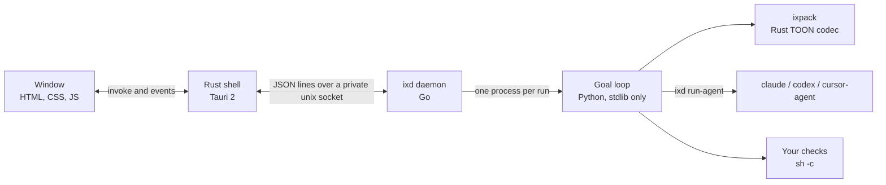

# How Iteraxa works

The [README](../README.md) covers using Iteraxa. This page is for when you want to know what happens underneath: the parts, where your data lives, how teams are staffed, and how to run the goal loop from a terminal.

## The parts



| Part | Where | Owns |
| --- | --- | --- |
| Rust shell | `app/` | Window, theme, editors, agent detection, check suggestions, the daemon client |
| Daemon | `cmd/ixd`, `internal/daemon` | Queue and parallel runs, one run per folder, history, pausing and resuming, stopping, crash cleanup, notifications |
| Agent runner | `internal/agent` | One CLI call: flags, sandbox and network modes, timeout, cost and token parsing |
| Goal loop | `python/iteraxa` | Checks, turn notes, stuck detection, hand-offs, questions, hypotheses, reports, usage-limit pauses; the team roster and workspace copies in `team.py` |
| Codec | `rust/ixpack` | TOON encode and decode, prompt packing and failure trimming |

Waiting for you is just the loop exiting: when you answer a question or raise a limit, the daemon rewrites the goal and starts a fresh loop process, which picks up from the run's saved state. A usage-limit pause is the exception: the loop stays up and sleeps. If the background service itself dies, the runs it had going are marked interrupted and their processes killed; start them again with **Run again**.

## How a team is staffed

A team round has a cheap **lead** that reads the goal, the failure and the ledger, then staffs the round. Iteraxa enforces limits on whatever the lead asks for:

| Role | What it does | Limits Iteraxa enforces |
| --- | --- | --- |
| Lead | Plans the round and estimates what finishing will cost | The cheapest installed model, read-only |
| Investigators | Each tests one theory in a throwaway copy of your folder | Never premium models; their copies are deleted |
| Implementer | Makes the fix in your folder | Stronger models the longer the run is stuck |
| Competing attempts | When stuck, two or more models fix it in separate copies, from different vendors when possible | Iteraxa runs your checks in every copy and applies the best one only if it does better than your folder now: more checks passing, or as many with a different failure |
| Reviewer | Reads the diff once every check passes, looking for weakened tests or hard-coded results | From another vendor whenever one is installed |

Premium models (Opus, Codex Astra, Grok 4.7 at extra-high effort) are used only for hard problems or when stuck, and at most 8 agents run at once. Copies are git worktrees of your current working state, uncommitted edits included, or copy-on-write copies for folders that aren't repositories. Big dependency folders such as `node_modules`, `.venv` and `target` are linked, not copied.

With **Size to the problem** on, the lead's first estimate sets the run's budget and rounds, but only within the limits you started with. It can size a run down; it can't raise it. If it thinks the goal needs more, the run stops at your limit and offers the lead's estimate as the new one.

## Where your data lives

Everything lives in one data folder: `~/Library/Application Support/Iteraxa` on macOS, and `~/.local/share/iteraxa` (or `$XDG_DATA_HOME/iteraxa`) on Linux. `ITERAXA_DATA` overrides both when it's set in the app's environment. Each run gets its own `runs/<id>/` folder:

| File | What's in it |
| --- | --- |
| `goal.toon` | The goal as the loop reads it, including your answers |
| `meta.json` | The run's status, spend and checks, as the window shows them |
| `events.jsonl` | Every event the loop emitted, timestamped |
| `state.json` | What a paused or resumed run picks up from |
| `ledger.toon` | The notes that go into the next prompt |
| `calls.jsonl` | Every agent call with its role, model, cost, duration and reply (the last 32 KB) |
| `loop.log` | What the loop wrote to stderr, including the traceback if it crashed |
| `report.html` | The final report, when the goal was reached |

## Running the loop from a terminal

The goal loop also runs without the window. A goal file looks like [`examples/coding.toon`](../examples/coding.toon):

```
intent: Make the project tests exit 0
agent: claude
budget_usd: 2
max_turns: 8
checks[1|]{id|cmd}:
  tests|python3 check.py
```

```sh
go build -o target/ixd ./cmd/ixd && cargo build --release -p ixpack
IX_BIN=target/ixd IXPACK_BIN=target/release/ixpack \
  PYTHONPATH=python python3 -m iteraxa run --goal examples/coding.toon --workspace /path/to/project
```

Other fields: `kind` (`code`, `research` or `hypothesis`), `hypothesis`, `team`, `auto_limits`, `autonomous`, `allow_network`, `switch_agent` and `hints` (your answers), plus settings the app fills in: `check_timeout`, `lean`, `report` and `model_claude`, `model_codex`, `model_cursor`. Run it again with a higher `budget_usd` or `max_turns` and it continues from its state folder.

| Exit code | Meaning |
| --- | --- |
| 0 | Finished: the goal was reached, or an autonomous run was judged good enough |
| 1 | The goal file couldn't be read or isn't valid |
| 2 | Stopped short: budget, turns, no agent left, an error mid-run, or you stopped it |
| 3 | Waiting for you: approve checks or answer a question |

## Measuring prompt size

The README's prompt-size chart comes from [`scripts/prompt-size-chart.py`](../scripts/prompt-size-chart.py). It runs the real loop code and `ixpack` on a synthetic 20-turn run and redraws `docs/prompt-size-*.svg`:

```sh
cargo build -p ixpack
IXPACK_BIN=target/debug/ixpack PYTHONPATH=python python3 scripts/prompt-size-chart.py
```
